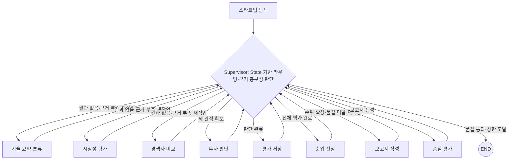

# AI Startup Investment Evaluation Agent

본 프로젝트는 Semiconductor(AI 반도체) 스타트업에 대한 투자 가능성을 기술·시장·경쟁 관점에서 평가하는 Supervisor 패턴 기반 멀티 에이전트를 설계하고 구현한 실습 프로젝트입니다.

## Overview

- Objective : AI 반도체 스타트업 20개(국내 10, 해외 10)의 시장성, 제품/기술력, 경쟁 우위, 성장가능성, 투자조건 등을 기준으로 투자 적합성 분석
- Method : LangGraph Multi Agent, Agentic RAG(기술 요약·기술 분류·시장성 평가), 웹 검색(경쟁사 비교), LLM Judge(투자 판단·보고서 품질 평가)
- Pattern : Supervisor — 우리 시스템의 핵심이 "근거가 충분한가"의 판단이라, 결과를 보고 부족하면 같은 에이전트에 재작업을 지시하는 Supervisor가 목적에 맞음. 한 번에 한 에이전트만 실행해 로컬 임베딩 모델(동시 실행 불가)과 API 호출 제한 문제가 없고, 라우팅·재작업 과정이 트레이스에 그대로 드러남
- 동적 처리 : 다음 노드를 순서표가 아닌 State(수집된 관점·근거 충분도·품질 평가 결과)로 매번 결정. 자료가 충분한 기업은 바로 판단으로 넘어가고, 근거가 부족한 관점은 검색 전략을 넓혀 재작업하며, 보고서 품질 평가가 미달이면 해당 관점 재조사 또는 보고서 재작성으로 되돌아감. 단계 수가 고정되지 않음
- Output : 전체 후보 평가 후 70점 이상 기업 중 1순위를 추천(없으면 전원 보류)하고 7페이지 PDF 투자 보고서 생성

## Selected Technologies

- HW : AI 반도체 스타트업 20개사(NPU, AI 가속기, CXL, 포토닉스 등) — AI 서비스의 성능·전력 효율을 좌우하는 기반 기술이고, 비상장·Seed~Series C 스타트업이 국내 10개·해외 10개로 고르게 있어 비교 평가가 가능
- SW : 별도 선정 없음

## Features

- PDF·웹 자료 기반 정보 추출: 기업 홈페이지·제품 문서·논문·보도자료(179페이지) + 시장조사 보도자료(21페이지) = 200/200페이지
- 모든 주장에 출처 URL·페이지·원문 인용을 붙이고 원문에 없는 인용은 제거, 근거가 없으면 `근거 부족`
- Supervisor의 근거 충분성 판단과 재작업: 기술 주장 2건 이상, 시장 규모·성장률, 경쟁사 2곳 이상·항목별 비교·서로 다른 출처 2개 이상
- 기술 분야에 맞는 세부 시장(엣지 AI·데이터센터 가속기·CXL·포토닉스·인메모리·칩렛) 규모·성장률 분석
- 경쟁사 2~3곳을 웹 검색으로 찾아 제품·성능·고객·특허·파트너십·양산 역량별 비교
- 설계서 Score Table·체크리스트(100점)로 채점, 항목별 한 줄 이유, 기술·운영·법률 치명 리스크 유형별 −10점, 3회 채점 중앙값
- 확증 편향 방지 전략 : 섹션마다 출처 1개 이상·보고서 전체 서로 다른 출처 3개 이상, 단일 출처 의존 50% 이하, 회사 자료 외 제3자 출처 확보, 경쟁사가 앞서는 점도 기록, 근거 없는 홍보 표현은 "회사 주장"으로 표시, 기술의 새로움만으로 판단하지 않도록 다분야 근거 요구
- 보고서 품질 평가 : Groundedness·중립성·편향 통제 3개 항목을 규칙 검사 8개 + LLM Judge 3개(Hybrid)로 평가, 미달 시 재작업·재작성 루프(최대 2회). 더 확보할 자료가 없는 관점은 재조사 대신 보고서 재작성
- 에이전트 결과만으로 7페이지 한국어 보고서(표·그래프·인용 번호·가이드 형식 Reference) 생성
- 검색 품질 평가(Hit Rate@K, MRR)와 단계별 Supervisor 결정 출력

## Tech Stack

- Framework : LangGraph
- LLM/Generator : OpenAI gpt-4o-mini (temperature 0)
- LLM/Judge : OpenAI gpt-4o-mini (투자 판단 3회 채점 중앙값, 보고서 품질 평가)
- Retrieval : FAISS (IndexFlatIP) - 기술 Hit Rate@3 0.978, MRR@10 0.923 (46문항) / 시장 Hit Rate@3 0.938, MRR@5 0.745 (16문항)
- Embedding : nlpai-lab/KURE-v1(한국어), jinaai/jina-embeddings-v5-text-small(영문·장문) 하이브리드
- Tracing : LangSmith / Web Search : Tavily / PDF : pypdf, Playwright, ReportLab

## Agents

- Supervisor : State를 보고 다음 노드를 결정(`add_conditional_edges`). 결과가 없는 관점은 실행, 근거가 부족한 관점은 재작업 지시, 판단이 끝난 기업은 저장, 전체 평가 후 순위 → 보고서 → 품질 평가, 품질 미달 시 재작업 대상 결정. 하위 에이전트는 Supervisor와만 통신
- 스타트업 탐색 : 팀이 검증한 후보 20개의 비상장·Seed~Series C·Exit 미완료 적격성 확인
- 기술 요약·분류 (RAG) : 기술 문서에서 핵심 기술·차별성·장점·한계·상용화 상태를 인용과 함께 정리하고 분야 분류 (재작업 시 검색 범위 확대)
- 시장성 평가 (RAG) : 세부 시장 보고서에서 시장 규모·CAGR·대상 고객·수요처 정리 (재작업 시 전체 세부 시장 탐색)
- 경쟁사 비교 : 웹 검색으로 경쟁사 2~3곳과 6개 항목 비교, 진입장벽 정리 (재작업 시 한국어·한계·경쟁사 강점 검색어 추가)
- 투자 판단 : Score Table·체크리스트 채점, 리스크 감점, 기준(70점) 통과 여부와 근거 기록
- 평가 저장·순위 선정 : 핵심 정보 부족 시 보류, 전체 평가 후 70점 이상 중 1순위 추천
- 보고서 작성 : 최종 State로 7페이지 PDF 작성 (품질 미달 후에는 근거 없는 문장 제외·표현 완화)
- 품질 평가 : Groundedness·중립성·편향 통제 평가, 미달 항목과 재작업 대상을 Supervisor에 보고

## State Schema

- 제어 vs 페이로드 분리 : 라우팅·종료·재개용 제어 메타(`trace_id`, `phase`, `candidate_index`, `next_agent`, `rework`, `rework_reason`, `report_attempts`, `step_count`, `node_status`, `last_error`)와 작업 결과(관점별 분석, 점수, 평가 이력, 순위, 보고서, 품질 verdict)를 구분. Supervisor는 제어 필드와 결과의 충분성만 보고 분기
- 관측성 위치 : 라우팅 사유·재작업 판단·품질 verdict는 State가 아닌 외부 결정 로그(`out/logs/{trace_id}.jsonl`)와 LangSmith 트레이스에 기록. State에는 마지막 결정 1건(`last_decision`)만 둠
- 지속성 비용 : 청크 본문·전체 출처를 State에 넣지 않고, 인용된 출처의 메타데이터와 300자 이내 근거 문장만 `sources`에 보관. 평가 이력은 근거 본문을 뺀 요약 레코드
- 상관 : `trace_id` 하나를 체크포인트 `thread_id`, LangSmith `metadata.trace_id`, 결정 로그 파일명에 함께 사용
- 재개/복구 : 단계마다 State를 SQLite 체크포인트 파일(`out/supervisor/checkpoints.sqlite`, 서버·계정 불필요)에 저장하고, 중단되면 `--resume <trace_id>`로 마지막 단계부터 이어서 실행(완료된 기업은 다시 평가하지 않음). `candidate_index`·`rework`·`node_status`·`last_error`로 진행 상태와 오류를 보존하고, 에이전트 오류는 `error`로 기록한 뒤 근거 부족으로 처리해 Supervisor가 재시도 후 계속 진행(fallback)
- 동시 처리 : Supervisor는 한 번에 하위 노드 하나만 실행해 동시 쓰기가 없음. 누적 필드는 reducer로 병합 규칙을 명시(`evaluation_history` 기업명 기준 upsert, `sources` source_id 기준 병합)
- 종료 보장 : `step_count ≤ max_steps`(기업당 14단계 + 20), 관점별 재작업 1회, 보고서 개선 2회 상한, LangGraph `recursion_limit` 안전망. 상한 도달 시 한계를 보고서에 명시하고 종료

## Architecture



<sub>**RAG 실습 설계서 대비 변경 사항**<br>
① 그래프: 첫 추천 기업에서 종료 → 20개사 전체 평가 후 70점 이상 기업 중 1순위 추천(없으면 전원 보류), `final_ranking`·`recommended_startup` 추가<br>
② State: 반복 제어·근거 전달용 필드 추가(`candidate_index`, `evaluation_history`, `source_evidence`, `evaluation_details` 등)<br>
③ 평가: 추천 기준선 70점 확정, 리스크는 기술·운영·법률 유형별 −10점, 3회 채점 중앙값 사용<br>
④ 핵심 정보: 기술 요약 필수 항목은 핵심 기술만(차별성은 점수표에서 평가)<br>
⑤ 임베딩: 언어별로 모델을 나누는 대신 두 모델로 모두 인덱싱하고 질문 특성에 따라 0.7/0.3 가중 결합<br>
⑥ 스타트업 탐색: 웹 검색 대신 팀이 검증한 후보 20개를 적격성 규칙으로 확인</sub>

## Directory Structure

```text
├── data/                  # 후보 목록, 기술·시장 자료 목록, 검색 정답셋
├── src/investment_scout/
│   ├── supervisor/        # 조정 계층: Supervisor·라우팅 규칙·State·품질 평가·관측성·그래프·실행기
│   ├── agents/            # 하위 에이전트: 탐색·기술 요약·기술 분류·시장성·경쟁사·투자 판단
│   ├── rag/               # 수집·파싱·청킹·임베딩·FAISS 검색·생성(프롬프트)·검색 평가
│   ├── reporting/         # 보고서 내용 추출·7페이지 PDF
│   └── nodes/, graph.py   # RAG 실습의 순차 그래프 (평가 저장·순위 규칙 재사용)
├── docs/                  # 기술 RAG·역할 3·보고서 상세 안내, Supervisor 그래프
├── tests/                 # 단위·통합 테스트 186개 (API 호출 없음)
├── out/                   # 수집 PDF·인덱스·최종 State·결정 로그·체크포인트 (Git 제외)
├── output/pdf/            # 투자 보고서 PDF (Git 제외)
├── app.py                 # 실행 스크립트
└── README.md
```

## Usage

```bash
# 1) 설치 (최초 1회)
uv sync --extra tech-rag --extra embeddings --extra live-search --extra report --group dev
uv run python -m playwright install chromium --only-shell
cp .env.example .env   # OPENAI_API_KEY, TAVILY_API_KEY, LANGSMITH_API_KEY 입력

# 2) 실행: 자료 준비(최초 1회 자동) → Supervisor 평가 → 보고서 → 품질 평가 → output/pdf/investment_report.pdf
uv run python app.py
uv run python app.py --max-candidates 3   # 앞의 3개 기업만 빠르게 확인
uv run python app.py --report-only        # 저장된 결과로 보고서만 다시 생성 (API 호출 없음)
uv run python app.py --resume <trace_id>  # 중단된 실행을 마지막 단계부터 이어서 실행

# 테스트
uv run pytest -q
```

실행 중 Supervisor의 결정(`🧭 Supervisor → market: 시장성 평가 결과 없음 → 실행`, 재작업은 🔁)과 에이전트 결과, 품질 평가 결과가 출력되고, 결정 로그는 `out/logs/{trace_id}.jsonl`, 트레이스는 LangSmith 프로젝트 `ai-investment-supervisor`에 남습니다. 웹 자료와 OpenAI 응답은 시점에 따라 달라질 수 있어 점수·순위가 실행마다 조금씩 다를 수 있습니다. 상세 안내: [기술 RAG](docs/tech_rag.md) · [시장·경쟁·투자 판단](docs/role3.md) · [보고서](docs/report_role4.md)

## Contributors
### RAG
- 신한수 : (예비군 훈련으로 인한 불참)
- 안영준 : 보고서 생성 Agent 개발, LangGraph 통합, PDF 시각화, Score & Citation 검증, 통합 테스트
- 정하윤 : 스타트업 탐색 Agent, 후보 순환·조건 분기 그래프, 후보 스타트업 선정·적격성 검증(국내 10 / 해외 10)
- 손수경 : PDF & Web Parsing, 문서 Chunking, KURE/Jina모델 활용 Embedding, FAISS Retrieval, Technical Summary & Classification Agents개발
- 손경락 : 기술 RAG 개선·검색 품질 평가, 시장성·경쟁사 비교·투자 판단 Agent 개발, 평가 기준 구현·순위 선정, 보고서 생성 Agent 수정, README 작성

### Agent
- 신한수 : State Schema 설계(제어/페이로드 분리, reducer, 종료 상한), SQLite 체크포인트·재개, trace_id 기반 결정 로그·LangSmith 추적 연동 및 트레이스 캡처
- 안영준 : 보고서 Agent 확장(전체 평가 결과·Supervisor 평가 과정·품질 평가 페이지), PDF 시각화, 통합 테스트, 제출물 패키징
- 정하윤 : Supervisor Agent·그래프 설계(State 기반 `add_conditional_edges` 라우팅, 하위 에이전트 통신 제약, 종료 판단), Supervisor 그래프 Mermaid
- 손수경 : 재작업용 재조사 검색(검색 범위 확대·한국어/한계/경쟁사 강점 검색어), 출처 다양성 확보, 검색 품질 지표(Hit Rate@K, MRR) 유지
- 손경락 : 하위 Agent(기술·시장·경쟁사·투자 판단) Supervisor 연동, 근거 충분성 규칙·재작업 지시, 보고서 품질 평가 노드(규칙 + LLM Judge Hybrid)·미달 시 Loop, README 작성
